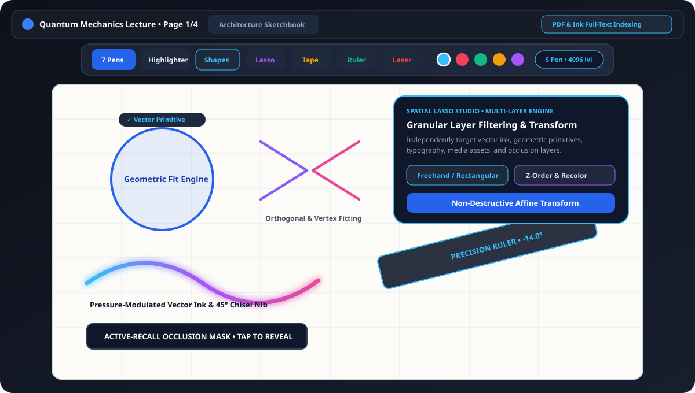
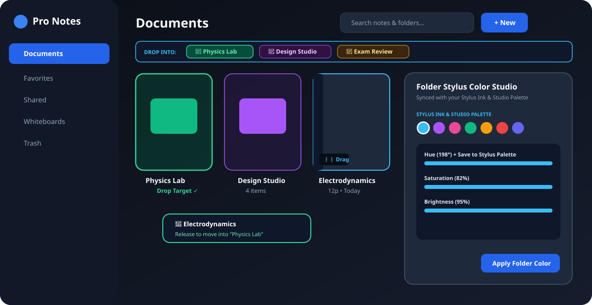

<div align="center">


# Pro Notes

**High-Performance Vector Handwriting, Geometric Drafting & PDF Workspace for Android**

[](https://github.com/ItzNikk/pro-notes/releases)
[](https://kotlinlang.org/)
[](https://developer.android.com/jetpack/compose)
[](https://developer.android.com/training/data-storage/room)
[](#hardware-stylus-integration)

</div>

---

## Overview

**Pro Notes** is a native Android note-taking, technical drafting, and document markup environment engineered in Kotlin and Jetpack Compose. Designed specifically for high-refresh-rate tablets, foldables, and active stylus hardware, it combines a low-latency vector ink pipeline with deterministic geometric shape recognition, multi-layer spatial manipulation, and full-text indexed PDF annotation.

All document data is persisted locally through an asynchronous Room SQLite architecture with optional AES-GCM cryptographic protection for confidential notebooks.

---

## Workspace Previews

### Vector Ink Canvas, Geometric Fitting & Multi-Layer Spatial Selection
<p align="center">
  
</p>

### Hierarchical Document Library & Directory Organization
<p align="center">
  
</p>

---

## Core Engineering Capabilities

### 1. Low-Latency Vector Ink Pipeline
- **Sub-Pixel Input Coalescing**: Processes raw stylus motion events with a `0.85px` distance threshold and decoupled pointer-state references (`rememberUpdatedState`), preventing coroutine teardown during active stroke capture.
- **Debounced Off-Thread Serialization**: Document state commits are serialized asynchronously on `Dispatchers.Default`, ensuring zero main-thread blocking between stylus lift and subsequent stroke initiation.
- **Parametric Nib Engines**:
  - **Fountain & Brush**: Continuous pressure- and velocity-modulated stroke envelopes with smoothed segment transitions.
  - **Calligraphy (45° Italic Chisel)**: Direction-dependent ribbon geometry that dynamically computes stroke width from instantaneous tangent angles.
  - **Technical Fineliner & Ballpoint**: Constant-width vector rendering optimized for mathematical notation, schematics, and dense handwriting.
  - **Chisel Marker & Multi-Pass Highlighter**: Translucent blend-mode rendering for non-destructive document emphasis.
- **Proximity-Gated Precision Ruler**: Interactive, rotatable straightedge overlay (`0.1°` angular precision) that restricts edge snapping strictly to strokes originating within the ruler's immediate boundary corridor.

### 2. Deterministic Geometric Recognition Engine
- **Stationary Hold-to-Snap Workflow**: Freehand strokes held stationary for `320ms` are evaluated in real time and converted in-place into mathematical vector primitives without interrupting continuous drawing flow.
- **Multi-Stage Classification Pipeline**:
  - **Pre-Classification Normalization**: Automatically trims stylus lift and closure overshoot (`StrokeResampler.trimClosureOvershoot`) prior to computing circularity, convex hull ratios, and bounding-box aspect metrics.
  - **Vertex & Curvature Fitting**: Combines Ramer-Douglas-Peucker polyline simplification (`RdpSimplifier`) with specialized fitters (`CircleOvalFitter`, `PolygonFitter`, `LineArrowFitter`) supporting **14 geometric primitives**—including circles, ellipses, orthogonal brackets, arrows, quadratic curves, triangles, rectangles, diamonds, parallelograms, regular polygons, and stars.
  - **Centroid-Anchored Resizing**: Closed primitives anchor around their computed geometric centroid upon recognition, allowing immediate radial scaling or vertex adjustment prior to stroke finalization.

### 3. Spatial Selection & Multi-Layer Manipulation
- **Dual-Topology Selection**: Supports both arbitrary freehand polygon containment and rectangular bounding-box queries across the canvas coordinate space.
- **Granular Layer Filtering**: Independently include or exclude **Vector Ink**, **Geometric Primitives**, **Typography Boxes**, **Embedded Media**, **Sticky Annotations**, and **Active-Recall Occlusion Masks** during selection operations.
- **Non-Destructive Transformations**: Perform affine translation, uniform bounding-box scaling, Z-order promotion/demotion (`Bring to Front` / `Send to Back`), clipboard serialization, and batch pigment recoloring across heterogeneous canvas elements.

### 4. PDF Ingestion, Markup & Full-Text Indexing
- **Native Multi-Page PDF Import & Export**: High-DPI page rendering via Android's `PdfRenderer` paired with vector-accurate PDF generation (`PdfDocument`) for lossless sharing and archival.
- **Automated Full-Text Extraction**: Extracts and indexes underlying PDF text streams during document ingestion (`PdfImportHelper`), enabling instantaneous keyword search across both library documents and active multi-page notebooks with one-tap page navigation.
- **Custom Cover Media & Writable Cover Surfaces**: Supports high-resolution custom cover imagery alongside procedural cover templates, with optional first-page canvas integration allowing direct stylus annotation on notebook covers.

### 5. Local-First Storage & Cryptographic Vault
- **Transactional Room SQLite Persistence**: Structured schema (`ProNotesDatabase` v3) storing multi-page vector paths, page templates, document hierarchies, and workspace preferences.
- **AES-GCM Encrypted Vault**: Sensitive documents moved to the Private Vault are protected via hardware-backed biometric authentication (`BiometricPrompt`) or SHA-256 PIN verification paired with `AES/GCM/NoPadding` authenticated encryption.

---

## Hardware Stylus Integration

Pro Notes interfaces directly with Android stylus pressure, tilt, orientation, and hardware button APIs across major OEM ecosystems:

| Hardware Platform | Pressure Resolution | Tilt & Azimuth Shading | Barrel / Action Button | Hover Reticle |
| :--- | :---: | :---: | :---: | :---: |
| **Samsung S Pen** (Galaxy Tab S / S Ultra) | 4,096 Levels | Supported | Configurable (Eraser / Lasso / Palette) | Supported |
| **Xiaomi Smart Pen** (Gen 1 & Gen 2) | 4,096 Levels | Supported | Primary & Secondary Action Mapping | Supported |
| **OnePlus Stylo / OPPO Pencil** | 4,096 Levels | Supported | Double-Tap & Barrel Switch | Supported |
| **Lenovo Precision Pen / Tab Pen Plus** | 4,096 Levels | Supported | Barrel Click Action | Supported |
| **Huawei M-Pencil** (Gen 2 / Gen 3) | 4,096 Levels | Supported | Double-Tap Tool Switch | Supported |
| **USI 2.0 Active Stylus** | 4,096 Levels | Supported | Barrel & Tail Eraser Support | Supported |

---

## System Architecture

```text
app/src/main/java/com/example/
├── MainActivity.kt                  # Application entry point, adaptive navigation shell & document I/O
├── data/
│   ├── ProNotesDatabase.kt          # Room SQLite database (v3), DAOs & serialized vector page entities
│   └── VaultCryptoManager.kt        # AES-256-GCM authenticated encryption & key derivation
├── model/
│   └── ProNotesModels.kt            # Immutable domain models (strokes, primitives, layers, workspace state)
├── shapes_engine/
│   ├── ShapeClassifier.kt           # Heuristic & geometric primitive classification pipeline
│   ├── CircleOvalFitter.kt          # Radial variance evaluation & ellipse parameter fitting
│   ├── PolygonFitter.kt             # Vertex angle analysis, quadrilateral & regular polygon fitting
│   ├── LineArrowFitter.kt           # Collinearity analysis, quadratic Bezier & arrowhead synthesis
│   ├── RdpSimplifier.kt             # Ramer-Douglas-Peucker polyline decimation
│   └── StrokeResampler.kt           # Equidistant path resampling & closure overshoot trimming
├── ui/
│   ├── components/                  # Contextual studio toolbars, spatial popovers & tab management
│   ├── screens/                     # EditorScreen, DocumentsScreen, SettingsScreen & OnboardingScreen
│   └── theme/                       # Material 3 adaptive color schemes (Light, Dark & True OLED Black)
├── util/
│   └── PdfImportHelper.kt           # PDF page rasterization, text stream extraction & export pipeline
└── viewmodel/
    └── ProNotesViewModel.kt         # Unidirectional StateFlow container, undo/redo stack & search indexer
```

---

## Build & Release Instructions

### Prerequisites
- **JDK**: Java 17 or newer
- **Android SDK**: API Level 35 (`compileSdk = 35`, `minSdk = 26`)
- **Build System**: Gradle 8.x (Kotlin DSL)

### Compiling Debug & Release Artifacts

```bash
# Clone the repository
git clone https://github.com/ItzNikk/pro-notes.git
cd pro-notes

# Assemble both Debug and Release APKs
gradle :app:assembleDebug :app:assembleRelease

# Run local JVM & Robolectric unit test suites
gradle :app:testDebugUnitTest
```

Compiled application packages are output to:
- **Release APK**: `app/build/outputs/apk/release/app-release.apk`
- **Debug APK**: `app/build/outputs/apk/debug/app-debug.apk`

### Publishing a GitHub Release

```bash
gh release create v2.5.0 \
  app/build/outputs/apk/release/app-release.apk \
  --title "Pro Notes v2.5.0" \
  --notes-file CHANGELOG.md
```

---

## License

Copyright © ItzNikk. All rights reserved.
