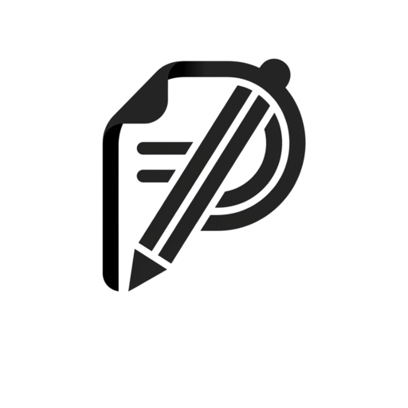

<div align="center">



# Pro Notes

**High-Performance Vector Handwriting, Stylus Gesture Intelligence & PDF Workspace for Android**

[](https://github.com/ItzNikk/pro-notes/releases/latest/download/ProNotes-v2.5.0.apk)
[](https://github.com/ItzNikk/pro-notes/releases/latest)
[](https://kotlinlang.org/)
[](https://developer.android.com/jetpack/compose)

</div>

---

## Overview

**Pro Notes** is a native Android note-taking, technical drafting, and PDF annotation workspace engineered in Kotlin and Jetpack Compose. Built for high-refresh-rate tablets, foldables, and active stylus hardware, it pairs a low-latency vector ink engine with zero-interruption stylus gestures—including **Circle-to-Lasso**, **Scribble-to-Erase**, **Hold-to-Erase**, **Hardware Palm Rejection**, and **Stationary Hold-to-Snap Geometry**.

---

## Download & Installation

Signed release packages are built and published automatically to **GitHub Releases**:

- **Direct APK Download**: [**`ProNotes-v2.5.0.apk`**](https://github.com/ItzNikk/pro-notes/releases/latest/download/ProNotes-v2.5.0.apk)
- **All Releases & Release Notes**: [**GitHub Releases (`v2.5.0`)**](https://github.com/ItzNikk/pro-notes/releases/latest)
- **Automated CI/CD Release Pipeline**: Pushing to `main` or tagging a `v*` release automatically triggers [`.github/workflows/android-release.yml`](.github/workflows/android-release.yml) to compile, sign, and attach `ProNotes-v2.5.0.apk` to the GitHub Releases page.
- **System Requirements**: Android 8.0 (API Level 26) or newer — optimized for Android 12L / 14 / 15 tablets, foldables, and active styluses.

---

## Intelligent Stylus Gestures & Input Pipeline

Pro Notes is designed around uninterrupted pen-on-glass workflows so users can write, correct, select, and draft geometry without repeatedly reaching for the toolbar:

- **Hardware Palm Rejection & Stylus-Only Filtering**: Evaluates `MotionEvent.TOOL_TYPE_STYLUS` and `MotionEvent.TOOL_TYPE_ERASER` at the pointer input layer to reject unintended palm and wrist contact on the display while preserving multi-touch two-finger pan and pinch-to-zoom (`50%–500%`) navigation.
- **Scribble-to-Erase**: Scratching rapidly back and forth over existing handwriting with any active pen automatically detects high-frequency oscillation reversals and erases the underlying ink strokes without switching tools.
- **Circle-to-Lasso**: Drawing an enclosing loop around strokes, shapes, or annotations and holding the stylus tip stationary at closure automatically transitions the loop into an active spatial **Lasso Selection** without leaving the Pen tool.
- **Hold-to-Erase & Barrel Button Switching**: Holding the physical stylus barrel button (or engaging temporary eraser hold) switches the active tool to the Eraser for immediate corrections and automatically restores the prior writing instrument upon release.
- **Stationary Hold-to-Snap Geometry (`320ms`)**: Pausing briefly at the end of a freehand stroke converts the path in-place into a mathematical vector primitive while keeping the pen active for continuous drawing.

---

## Core Engineering Capabilities

### 1. Low-Latency Vector Ink Engine
- **Sub-Pixel Input Coalescing**: Captures raw stylus motion events with a `0.85px` distance threshold and non-restarting pointer-state references (`rememberUpdatedState`), eliminating frame drops during rapid writing.
- **Debounced Off-Thread Serialization**: Room SQLite serialization runs asynchronously on `Dispatchers.Default`, preventing main-thread contention when lifting the stylus between consecutive strokes.
- **7 Parametric Writing Instruments**:
  1. **Fountain Pen**: Pressure- and velocity-modulated calligraphy taper with smoothed segment transitions.
  2. **Ballpoint Pen**: Uniform, crisp everyday ink for dense note-taking.
  3. **Brush Pen**: Wide dynamic pressure response for hand-lettering and shading.
  4. **Technical Fineliner**: Constant-width micro nib for schematics, graphs, and mathematical notation.
  5. **Calligraphy (45° Italic Chisel)**: Direction-modulated ribbon geometry computed from instantaneous stroke tangent angles.
  6. **Chisel Marker**: Bold square-capped felt marker for headings and diagrams.
  7. **Neon Glow Pen**: Multi-pass luminous halo rendering with a high-contrast core.
- **Proximity-Gated Rotatable Ruler**: Interactive straightedge overlay (`0.1°` angular precision) that snaps strokes initiated within the ruler's immediate boundary corridor while leaving distant handwriting unaffected.

### 2. Deterministic Geometric Recognition (14 Primitives)
- **Closure-Normalized Classification**: Pre-trims stylus lift and closure overshoot (`StrokeResampler.trimClosureOvershoot`) prior to evaluating circularity, convex hull area, and aspect ratios—ensuring hand-drawn loops reliably resolve to true circles and ellipses.
- **Supported Vector Primitives**: `Line`, `Arrow`, `Quadratic Curve`, `Circle`, `Ellipse`, `Triangle`, `Right Triangle`, `Rectangle`, `Diamond`, `Parallelogram`, `Pentagon`, `Hexagon`, `Star`, and `Orthogonal / Angle Brackets (> , < , L)`.
- **Centroid-Anchored Adjustment**: Recognized closed shapes anchor around their fitted geometric centroid during a stationary hold, allowing radial scaling or vertex adjustment prior to lifting the stylus.

### 3. Multi-Layer Spatial Selection & Transformation
- **Freehand & Rectangular Lasso Modes**: Switch between freehand polygon containment and rectangular bounding-box selection.
- **Granular 6-Layer Filtering**: Independently filter selections across **Handwriting Ink**, **Geometric Shapes**, **Text Boxes**, **Images & Stickers**, **Sticky Notes**, and **Study Tapes**.
- **Persistent Selection & Configurable Auto-Return**: Selections remain active after translation and scaling for multi-step adjustments (recoloring, duplication, Z-order `Bring to Front` / `Send to Back`, or **Handwriting-to-Text OCR conversion**), with an optional setting to automatically return to the Pen tool after moving.

### 4. Active-Recall Study Tapes & Washi Patterns
- **Occlusion Masking for Active Recall**: Mask definitions, formulas, or diagram labels with customizable tape strips and tap any strip to toggle translucent reveal mode during review.
- **7 Vector Pattern Styles**: *Solid Matte*, *Diagonal Stripes*, *Polka Dots*, *Grid Washi*, *Stardust Sparkle*, *Gradient Glow*, and *Exam Caution*, complete with batch **Reveal All / Cover All** page controls.

### 5. PDF Ingestion, Full-Text Indexing & Custom Covers
- **Native PDF Import & Vector Export**: High-DPI rendering via Android `PdfRenderer` and vector-accurate document export via `PdfDocument`.
- **Full-Text PDF & Notebook Search**: Automatically extracts and indexes embedded PDF text streams during import (`PdfImportHelper`), enabling instantaneous keyword search across the library and inside the active editor with one-tap page navigation chips.
- **Custom Cover Import & Writable Page-1 Covers**: Import custom cover images or select studio cover designs, and optionally render the notebook cover directly as **Page 1** so titles, signatures, and diagrams can be written directly on the cover surface.

### 6. Hierarchical Library & Cryptographic Vault
- **Folder-First Organization & Drag-and-Drop**: Directories are prioritized at the top of the workspace grid with drag-and-drop sorting into folder cards, breadcrumb trails, and quick-drop target strips.
- **AES-GCM Private Vault**: Sensitive notebooks stored in the Private Vault are encrypted via `AES/GCM/NoPadding` and gated behind hardware biometric authentication (`BiometricPrompt`) or SHA-256 PIN verification.

---

## Hardware Stylus Integration

| Hardware Platform | Pressure Resolution | Tilt & Azimuth Shading | Barrel / Action Button | Hover Reticle |
| :--- | :---: | :---: | :---: | :---: |
| **Samsung S Pen** (Galaxy Tab S / S Ultra) | 4,096 Levels | Supported | Eraser / Lasso / Palette | Supported |
| **Xiaomi Smart Pen** (Gen 1 & Gen 2) | 4,096 Levels | Supported | Primary & Secondary Buttons | Supported |
| **OnePlus Stylo / OPPO Pencil** | 4,096 Levels | Supported | Double-Tap & Barrel Switch | Supported |
| **Lenovo Precision Pen / Tab Pen Plus** | 4,096 Levels | Supported | Barrel Click Action | Supported |
| **Huawei M-Pencil** (Gen 2 / Gen 3) | 4,096 Levels | Supported | Double-Tap Tool Switch | Supported |
| **USI 2.0 Active Stylus** | 4,096 Levels | Supported | Barrel & Tail Eraser | Supported |

---

## System Architecture

```text
app/src/main/java/com/example/
├── MainActivity.kt                  # Application entry point, navigation host & document I/O
├── data/
│   ├── ProNotesDatabase.kt          # Room SQLite database (v3), DAOs & serialized page entities
│   └── VaultCryptoManager.kt        # AES-256-GCM authenticated encryption & key management
├── model/
│   └── ProNotesModels.kt            # Immutable domain models (strokes, primitives, layers, workspace state)
├── shapes_engine/
│   ├── ShapeClassifier.kt           # Deterministic geometric primitive classification pipeline
│   ├── CircleOvalFitter.kt          # Radial variance evaluation & ellipse fitting
│   ├── PolygonFitter.kt             # Vertex angle analysis, quadrilateral & regular polygon fitting
│   ├── LineArrowFitter.kt           # Collinearity analysis, quadratic Bezier & arrowhead synthesis
│   ├── RdpSimplifier.kt             # Ramer-Douglas-Peucker polyline decimation
│   └── StrokeResampler.kt           # Equidistant path resampling & closure overshoot trimming
├── ui/
│   ├── components/                  # Studio toolbars, spatial Lasso/Tape popovers & tab bar
│   ├── screens/                     # EditorScreen, DocumentsScreen, SettingsScreen & OnboardingScreen
│   └── theme/                       # Material 3 adaptive color schemes (Light, Dark & True OLED Black)
├── util/
│   └── PdfImportHelper.kt           # PDF page rasterization, text stream extraction & export pipeline
└── viewmodel/
    └── ProNotesViewModel.kt         # Unidirectional StateFlow state container, undo/redo & search indexer
```

---

## Building from Source

```bash
# Clone the repository
git clone https://github.com/ItzNikk/pro-notes.git
cd pro-notes

# Compile Debug and Release APKs
gradle :app:assembleDebug :app:assembleRelease

# Run JVM & Robolectric unit tests
gradle :app:testDebugUnitTest
```

---

## License

Copyright © ItzNikk. All rights reserved.
